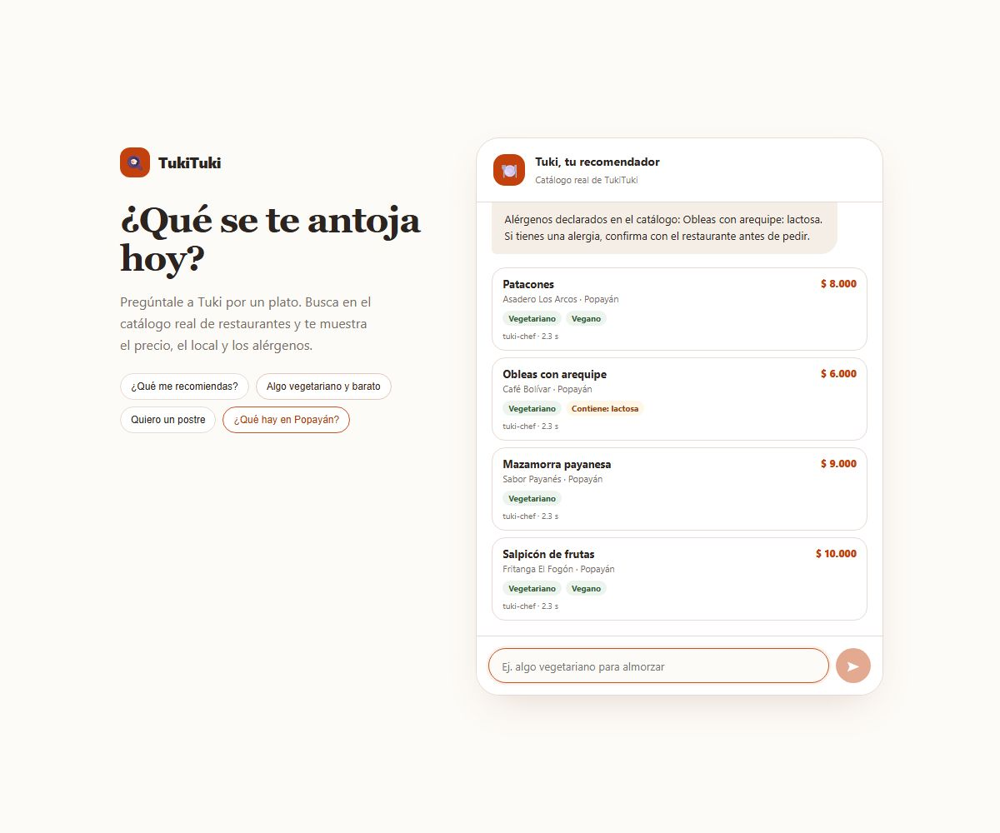

# Tuki RAG Chatbot

Chatbot local que recomienda platos de TukiTuki usando RAG sobre el catálogo
real de restaurantes. Corre con Ollama en la misma máquina, sin Groq y sin
OpenWebUI.



## Qué hace

El usuario escribe algo como “quiero algo vegetariano y barato” y el bot busca
en el catálogo, recomienda platos que existen y muestra el restaurante, el
precio y los alérgenos. Si no encuentra datos, lo dice en vez de inventar.

La API responde en `POST /api/v1/ai/recomendar`. La página web de `web/` es un
cliente mínimo que consume esa misma API.

## Cómo levantarlo

Necesitas Docker y unos 4 GB de RAM libres para Ollama.

```bash
docker compose up -d
```

La primera vez descarga el modelo de chat y el de embeddings, y crea
`tuki-chef` con el `Modelfile`. Puede tardar unos minutos.

Luego abre:

- Chat: <http://localhost:8000>
- Documentación de la API: <http://localhost:8000/docs>
- Estado del índice: <http://localhost:8000/api/v1/ai/conocimiento>

Si quieres correrlo sin Docker:

```bash
python -m venv .venv
.venv\Scripts\pip install -r requirements-dev.txt
ollama create tuki-chef -f Modelfile
uvicorn app.main:app --port 8000
```

## Cómo está armado

```text
web/index.html
     │  POST /api/v1/ai/recomendar
     ▼
FastAPI (app/main.py)
     ├── catálogo JSON ──► datos/catalogo.json
     ├── índice híbrido (BM25 + embeddings)
     ├── prompt con contexto
     └── Ollama (tuki-chef + nomic-embed-text)
```

El catálogo es una foto de la base de datos de TukiTuki. En el proyecto
completo, el gateway consulta `restaurantes-service` por HTTP; aquí se usa
`datos/catalogo.json` para que el repositorio se pueda reproducir solo.

## Base de conocimiento

- **7 restaurantes** y **61 platos**.
- Cada plato es un documento atómico: nombre, restaurante, ciudad, categoría,
  precio, descripción, ingredientes, alérgenos y etiquetas.
- Cada restaurante es otro documento: cocinas, horario, dirección, teléfono y
  valoración media.
- **Corte: 220 tokens. Solapamiento: 40 tokens (18 %).**
- Los platos y las fichas cortas no se parten.

La lista completa está en [`conocimiento/catalogo.md`](conocimiento/catalogo.md)
y la explicación en [`conocimiento/README.md`](conocimiento/README.md).

## Recuperación

No uso solo embeddings. Para un menú, la coincidencia exacta de un plato o un
ingrediente importa mucho, así que combino:

1. **BM25** en Python puro, con normalización de acentos y sinónimos.
2. **Embeddings** de `nomic-embed-text`.
3. **RRF** para fusionar los dos rankings.
4. Filtros de dieta, precio, ciudad, restaurante y alérgenos.
5. **MMR** para diversificar restaurantes.

Las preguntas factuales (dirección, horario, precio, ingredientes, alérgenos) se
responden directo desde el catálogo, sin pasar por el modelo. Eso evita que un
modelo de 1.5B invente un precio o una dirección.

## Modelo

- Base: `qwen2.5:1.5b-instruct` (Q4).
- Modelo personalizado: `tuki-chef`, creado con `Modelfile`.
- Embeddings: `nomic-embed-text`.
- `temperature=0.1`, `num_ctx=3072`, `num_predict=200`, `keep_alive=15m`.

Elegí 1.5B porque el equipo trabaja en un portátil con 16 GB de RAM y sin GPU
dedicada. Un modelo más grande no cabría con comodidad junto al resto del
entorno. En caliente responde a 8–10 tokens/s.

## Pruebas

```bash
pytest
ruff check app pruebas evaluacion
```

Las pruebas cubren chunking, BM25, filtros, alérgenos, índice, recomendador y
API. No necesitan Ollama real: usan dobles y `respx`.

## Evaluación

El Golden Dataset tiene **52 casos**:

```bash
python evaluacion/evaluate_rag.py
```

La última ejecución completa dio:

| Métrica | Valor |
|---|---:|
| Casos | 52 |
| Éxitos | 52 |
| Tasa de éxito | **100 %** |
| Error | 0 % |
| Latencia media | 1.701 ms |
| Latencia p50 | 62 ms |
| Latencia p95 | 9.113 ms |

En esta corrida los 52 casos pasaron. La mejora clave fue filtrar por categoría
cuando la pregunta pide un postre o algo para tomar; antes el modelo recomendaba
una pizza para beber.

Los resultados están en [`evaluacion/resultados`](evaluacion/resultados) y el
resumen visual en `docs/capturas/evaluacion.jpeg`.

## Estructura

```text
app/
  adaptadores/    Ollama y lector del catálogo
  dominio/        texto, documentos, BM25, RRF, MMR
  servicios/      conocimiento, chat y recomendador
  main.py         API y página web
datos/            catálogo exportado de PostgreSQL
conocimiento/     documentos legibles y explicación del corte
evaluacion/       Golden Dataset, evaluador y resultados
pruebas/          pruebas unitarias y de integración
web/              chat mínimo en HTML/JS
docs/             informe en PDF/DOCX y capturas
```

## Limitaciones

- El catálogo es un snapshot. Para datos en vivo hay que volver a exportarlo o
  conectar el adaptador al servicio de restaurantes.
- El modelo de 1.5B a veces ignora una regla del prompt. Por eso los datos
  exactos y los filtros estrictos se resuelven de forma determinista.
- El repo no incluye autenticación ni rate limit; es una entrega académica.
- Para producción habría que agregar HTTPS, cuota por IP y un volumen para el
  índice.

## Informe

El documento de la actividad está en:

- `docs/Informe-modelo-rag-TukiTuki.pdf`
- `docs/Informe-modelo-rag-TukiTuki.docx`

