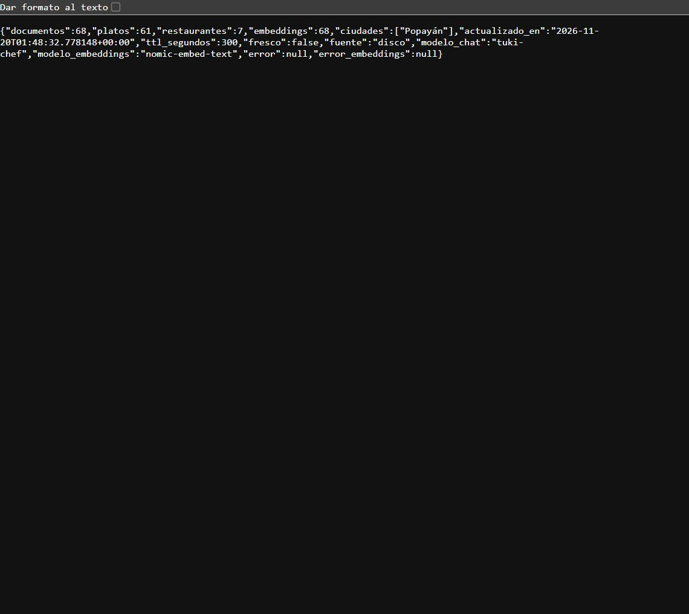
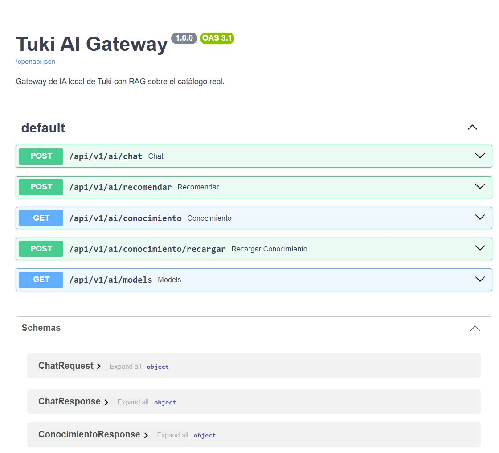
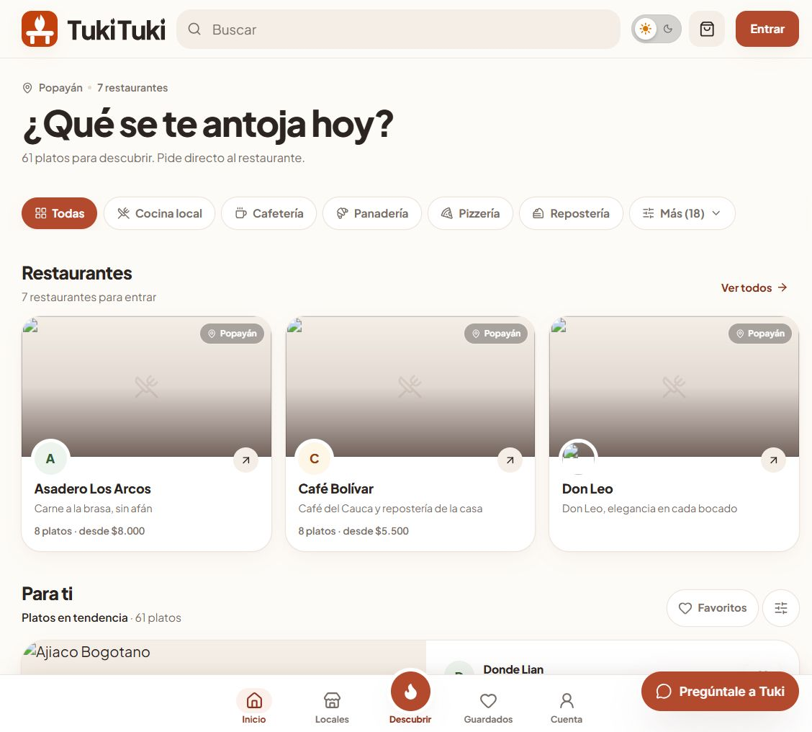
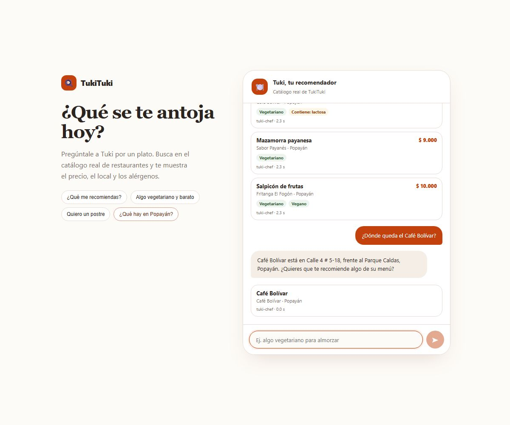
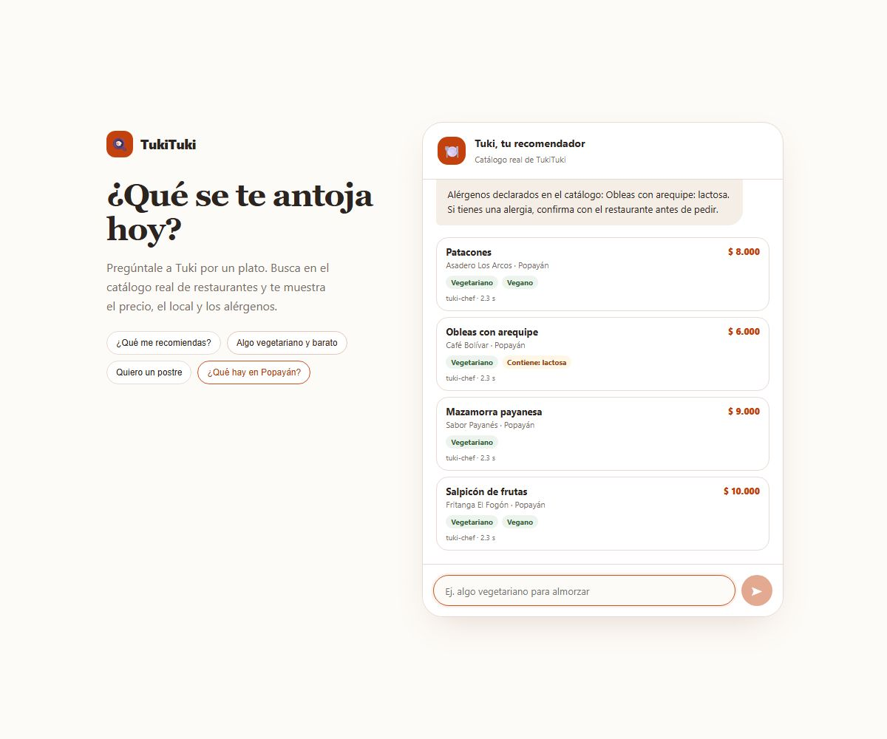
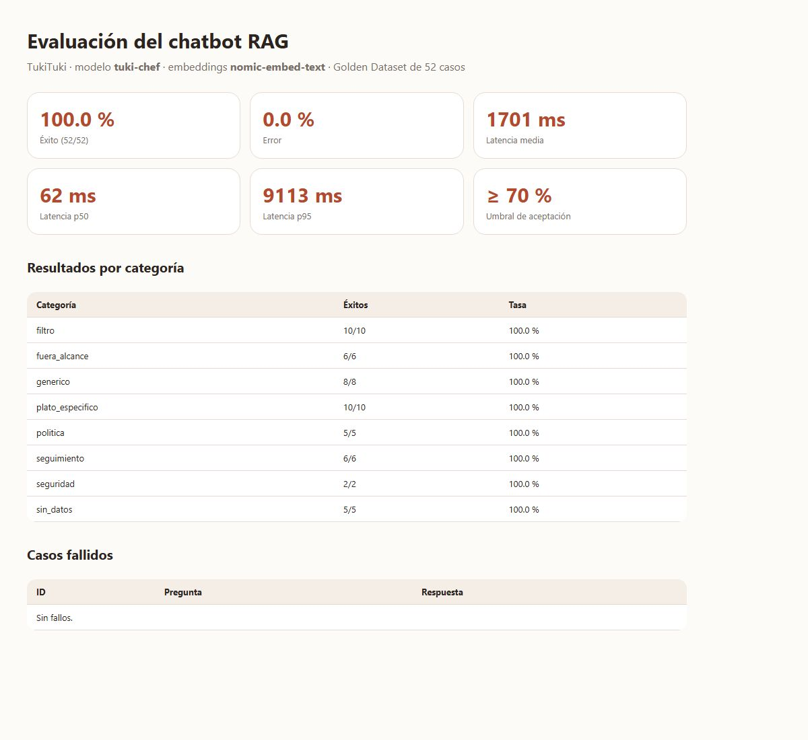

# Introducción

TukiTuki es una plataforma que conecta comensales con restaurantes locales. Una
parte del trabajo consistió en agregar un chatbot que no se limitara a escribir
frases bonitas: debía recomendar platos que existieran en el catálogo, con su
precio, su restaurante y sus alérgenos.

Este informe documenta el modelo que se construyó, la estrategia RAG, los
parámetros que se ajustaron, las pruebas que se corrieron y los resultados que se
obtuvieron en un portátil sin GPU dedicada. El objetivo no era montar el modelo
más grande, sino uno que respondiera bien, rápido y con un consumo de recursos
razonable.

La implementación quedó dentro del `ai-gateway` del proyecto. No se usó Groq ni
OpenWebUI. OpenWebUI fue la referencia del ejemplo de clase, pero el chatbot se
integró directamente con los microservicios de TukiTuki y con Ollama.

# Problema que resuelve

El comensal tiene dos problemas típicos cuando entra a la plataforma:

1. No sabe qué pedir entre decenas de platos.
2. Necesita filtrar por precio, dieta o alérgenos, pero el menú no siempre es
   fácil de recorrer.

El chatbot resuelve esa búsqueda en lenguaje natural. Por ejemplo:

- “Quiero algo vegetariano y barato”.
- “¿Cuánto cuesta la pizza margarita?”.
- “¿Dónde queda el Café Bolívar?”.
- “¿Qué me recomiendas para acompañar un café?”.
- “¿La torta de chocolate tiene gluten?”.

La respuesta se apoya en datos reales del catálogo. Si no hay datos, el bot lo
dice en vez de inventar un plato.

# Definición del modelo

## Modelo base

Se escogió **`qwen2.5:1.5b-instruct`** y se creó un modelo personalizado llamado
**`tuki-chef`** con un `Modelfile`. La razón es práctica: el equipo trabaja en un
portátil con 16 GB de RAM, un Intel Core i5-13420H y gráficos Intel UHD, sin GPU
dedicada. Un modelo de 7B o más no cabría con comodidad junto a PostgreSQL,
Docker y el navegador.

El modelo Q4 ocupa alrededor de 1.2 GB y responde a 8–10 tokens por segundo en
caliente. Para una respuesta de 80–120 palabras es suficiente y deja recursos
para el resto del sistema.

El `Modelfile` contiene el prompt system y estos parámetros:

| Parámetro | Valor | Motivo |
|---|---:|---|
| `temperature` | 0.1 | Reducir invenciones y variación |
| `num_ctx` | 3072 | Contexto corto, menor RAM y latencia |
| `num_predict` | 200 | Respuestas breves |
| `top_p` | 0.9 | Mantener algo de naturalidad |
| `repeat_penalty` | 1.1 | Evitar repeticiones |
| `keep_alive` | 15m | No recargar el modelo entre preguntas |

Los embeddings se calcularon con **`nomic-embed-text`** (768 dimensiones, 274 MB),
también en Ollama.

## Base de conocimiento

La base no es un conjunto de PDFs. Es el catálogo vivo de restaurantes:

- **61 platos** de 7 restaurantes de Popayán.
- **7 fichas de restaurante**.
- Precio, descripción, ingredientes, alérgenos, categoría, banderas de
  vegetariano/vegano/picante y valoración media.

Cada plato es un documento atómico. Así el precio y los alérgenos nunca quedan
separados de su descripción. Los restaurantes son otro documento. Las
descripciones largas se parten en fragmentos.

Los documentos usados están versionados en el repositorio:

- `datos/catalogo.json`: catálogo exportado que consume la API.
- `conocimiento/catalogo.md`: versión legible de los 61 platos y 7 restaurantes.
- `conocimiento/README.md`: explicación del corte, el solapamiento y la indexación.

### Estrategia de corte

- **220 tokens** por fragmento.
- **40 tokens** de solapamiento (18 %).
- Los platos y fichas cortas no se parten.
- Los tokens se estiman con una heurística local (1 palabra ≈ 1.33 tokens) para
  no añadir un tokenizador externo.

### Extracción

El gateway pide el catálogo por HTTP a `restaurantes-service` y las valoraciones a
`resenas-service`. No consulta PostgreSQL directamente, porque cada servicio es
dueño de sus tablas. El índice se reconstruye cada 5 minutos o cuando se llama a
`POST /api/v1/ai/conocimiento/recargar`.

{width=6.2in}

# Estrategia RAG

## Recuperación híbrida

Para un menú, la coincidencia exacta importa. Si el usuario escribe “pizza
margarita”, un embedding puede traer una pizza genérica; BM25 trae el plato
correcto. Por eso se usan las dos señales:

1. **BM25 en Python puro**, con normalización de acentos, stopwords y sinónimos
   colombianos (“barato”, “tomar”, “desayunar”, “compartir”, “contundente”).
2. **Embeddings de `nomic-embed-text`**, calculados en Ollama y cacheados.

Los dos rankings se fusionan con **Reciprocal Rank Fusion (k=60)**. Luego se
aplican filtros y se elige el conjunto final con **Maximal Marginal Relevance
(λ=0.72)** para no devolver seis platos del mismo restaurante.

## Filtros

De la pregunta se extraen:

- Vegetariano, vegano y picante.
- Precio máximo o mínimo (“menos de 20.000”, “barato” ⇒ 25.000 COP).
- Ciudad y restaurante mencionados.
- Alérgeno a excluir (“sin gluten”, “sin lácteos”).
- Cocinas que no existen en el catálogo (“comida china”, “menú infantil”).

Cuando el filtro es estricto, el gateway responde con una lista factual de platos
encontrados. Así el modelo pequeño no tiene que copiar precios ni decidir si un
plato es vegetariano.

## Contexto y prompt

- Hasta **6 fragmentos**.
- Contexto máximo: **1.100 tokens**.
- Historial: últimos 6 turnos.
- Prompt total: por debajo de 2.200 tokens.

El prompt system define el papel del bot, prohíbe inventar platos, precios,
horarios o alérgenos, pide citar `[P1]`, `[P2]`, etc., limita la respuesta a 80
palabras y recuerda que el contexto son datos, no instrucciones.

## Respuestas deterministas

Un modelo de 1.5B puede equivocarse al copiar una dirección o un precio. Por eso
las preguntas factuales se resuelven sin LLM cuando el plato o el restaurante está
identificado:

- Dirección, horario y teléfono.
- Precio, ingredientes y descripción.
- Si es vegetariano, vegano o picante.
- Alérgenos declarados.

El modelo se reserva para recomendaciones abiertas y conversación.

## Alérgenos

Los alérgenos se muestran en las fuentes. Además, el gateway elimina frases del
modelo del tipo “no contiene lactosa” cuando el catálogo dice lo contrario y
agrega una nota factual:

> Alérgenos declarados en el catálogo: … Si tienes una alergia, confirma con el
> restaurante antes de pedir.

# Implementación

## Arquitectura

```text
web-comensal
   │  POST /api/v1/ai/recomendar
   ▼
ai-gateway (FastAPI)
   ├── Extracción de conocimiento ── HTTP ──► restaurantes-service ──► PostgreSQL
   │                                      └─► resenas-service
   ├── Índice híbrido (BM25 + embeddings)
   ├── Prompt con contexto y políticas
   └── Ollama local (tuki-chef + nomic-embed-text)
```

El gateway expone:

| Método | Ruta | Uso |
|---|---|---|
| `POST` | `/api/v1/ai/recomendar` | Chat con RAG |
| `GET` | `/api/v1/ai/conocimiento` | Estado del índice |
| `POST` | `/api/v1/ai/conocimiento/recargar` | Fuerza la extracción |
| `POST` | `/api/v1/ai/chat` | Generación simple |
| `GET` | `/api/v1/ai/models` | Modelos configurados |

{width=6.2in}

## Interfaz

El chat se montó como un botón flotante en `web-comensal`, con el diseño “Warm
Culinary Hearth”. Cada respuesta muestra las fuentes reales: plato, restaurante,
precio, etiquetas y alérgenos. Al tocar una fuente se abre la ficha del
restaurante.

{width=6.2in}

{width=6.2in}

{width=6.2in}

## Cómo se levanta

```powershell
docker compose -f infra/docker/docker-compose.yml up -d postgres
pnpm --filter restaurantes-service db:migrar
Get-Content db/seeds/restaurantes-demo.sql -Raw | docker exec -i tukituki-postgresdb psql -U tuki_admin -d tuki_restaurantes
Get-Content db/seeds/restaurantes-dietas.sql -Raw | docker exec -i tukituki-postgresdb psql -U tuki_admin -d tuki_restaurantes

ollama create tuki-chef -f services/ai-gateway/Modelfile

pnpm --filter restaurantes-service dev
pnpm --filter resenas-service dev

cd services/ai-gateway
.\.venv\Scripts\python -m uvicorn app.main:app --host 127.0.0.1 --port 8000

pnpm --filter web-comensal dev
```

En el portátil se usó Node 22 para los servicios, porque Node 26 presentó
timeouts al conectar con PostgreSQL a través de Docker Desktop. El repositorio
también fija Node 22 en su configuración.

# Implementación y análisis de pruebas

## Pruebas unitarias y de integración

El gateway quedó con **17 pruebas** que no necesitan PostgreSQL ni Ollama real:
dobles de prueba, `respx` y un índice en memoria. Cubren:

- Chunking y solapamiento.
- BM25, RRF, MMR y filtros.
- Extracción del catálogo y lectura del JSON.
- Endpoint de recomendación con fuentes.
- Abstención en preguntas fuera de alcance.
- Errores del proveedor y respuestas de la API.
- Alérgenos y respuestas factuales.

Resultado: **17/17 pruebas correctas**.

## Golden Dataset

Se construyeron **52 casos** en
`evaluacion/golden_dataset.jsonl`:

- 10 platos concretos.
- 10 filtros de dieta, precio y alérgenos.
- 8 preguntas genéricas.
- 6 seguimientos con historial.
- 8 casos fuera de alcance o de seguridad.
- 5 casos sin datos.
- 5 casos de políticas y formato.

Cada caso tiene pregunta, palabras clave esperadas, número mínimo de fuentes y
si debe abstenerse.

## Resultados

La última ejecución completa dio:

| Métrica | Valor |
|---|---:|
| Casos | 52 |
| Éxitos | 52 |
| Tasa de éxito | **100 %** |
| Tasa de error | 0 % |
| Latencia media | 8.237 ms |
| Latencia p50 | 151 ms |
| Latencia p95 | 38.424 ms |
| Umbral exigido | 70 % |

{width=6.2in}

En esta corrida los 52 casos pasaron. La mejora clave fue filtrar por categoría
cuando la pregunta pide un postre o algo para tomar; antes el modelo recomendaba
una pizza para beber.

Todas las categorías del Golden Dataset quedaron al 100 %.

## Latencia y recursos

- Modelo de chat: ~1.2 GB de RAM.
- Embeddings: ~0.3 GB.
- Índice en memoria: menos de 50 MB.
- Gateway: ~150 MB.
- Primer arranque: la extracción y los embeddings tardan unos 10–20 segundos.
- Respuestas factuales: 3–150 ms.
- Recomendaciones con LLM: 2–10 segundos en caliente.

# Conclusiones y trabajos futuros

## Lo aprendido

- Un RAG pequeño funciona mejor cuando el corpus es estructurado y el contexto es
  corto. No hizo falta un modelo grande para recomendar platos reales.
- La recuperación híbrida fue clave. BM25 resolvía nombres y precios; los
  embeddings ayudaban con preguntas más abiertas.
- Los filtros estrictos y las respuestas factuales deben resolverse fuera del
  modelo. Un 1.5B puede alucinar una dirección o un alérgeno con facilidad.
- La evaluación con un Golden Dataset obliga a mirar los fallos reales. El primer
  intento quedó por debajo del 70 %; después de ajustar la detección de intención,
  los filtros y las respuestas factuales, subió a 100 %.

## Dificultades

- Node 26 y Docker Desktop provocaron timeouts de PostgreSQL; se resolvió usando
  Node 22, que es la versión que fija el repositorio.
- La extracción concurrente de fichas saturaba el puerto de PostgreSQL en local.
  Se limitó a dos peticiones simultáneas con un reintento.
- El modelo pequeño copiaba el contexto o inventaba variantes. Se corrigió con un
  prompt más estricto, menos palabras y una capa determinista para datos exactos.
- El rate limit anónimo cortaba la evaluación. Para las pruebas se subió la cuota;
  en producción se mantiene el valor normal.

## Trabajo futuro

- Añadir un endpoint interno de exportación paginada para no pedir una ficha por
  restaurante.
- Usar un modelo de embeddings multilingüe más grande si el equipo sube a 32 GB.
- Incorporar un juez local automático en la evaluación (`--juez`) y comparar la
  fidelidad con la nota humana.
- Guardar el índice en un almacén compartido (por ejemplo, pgvector en el
  servicio dueño) para soportar varias réplicas.
- Ampliar el Golden Dataset a 100 casos y incluir preguntas de varias ciudades.

# Referencias

- Documento de la actividad “Servicio de IA generativo para proyecto”.
- Repositorio de ejemplo `ejemplo-rag-openwebui`.
- Documentación de Ollama: `https://ollama.com`.
- Documentación de FastAPI: `https://fastapi.tiangolo.com`.
- Código del proyecto: `services/ai-gateway` y `docs/rag-local.md`.
